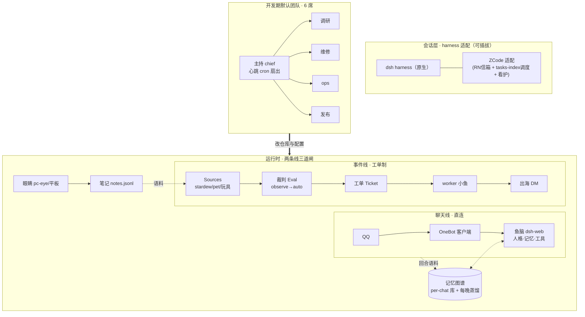

# 00 · 新手上路：从部署一条鱼，到搭起一支会自动干活的团队

> 目标读者：第一次接触本仓的人。读完能回答三个问题：**怎么把一条鱼部署起来、怎么让事件线自己开工、怎么搭一支会推进项目的团队**。
> 路线图：第一节条鱼（30 分钟）→ 第一张工单（1 小时）→ 搭自己的默认团队（半天）。

## 总览图（先看懂再动手）



一图记住三句话：

1. **聊天永远直连**（延迟敏感、人格连续，不进工单）；
2. **其余一切事件走工单**（接收→裁判→worker→出海，每一步可审计、可回滚）;
3. **观察先于自动**（新来源先 observe 看 `would_accept`，对上人工判断再切 auto）。

---

## 第一节条鱼（30 分钟）

```bash
cd install && bash 01-system.sh --verify && bash 02-onebot.sh   # 占位符已在 env.example 里配好
```

- 走 [docs/04-deploy.md](04-deploy.md) 的 01–05 步：基础系统 → OneBot 客户端 → dsh 平台 → 记忆空库 → 聊天线接线。
- 验收：QQ 发一句话有回复；`kill dsh-web && 重启` 后她还认得你（记忆连续）。

## 第一张工单（1 小时）

```bash
bash install/08-superagent.sh && bash examples/weather/demo.sh --observe
```

- 玩具源 `examples/weather`：一个只会「报告天气异常」的 Source，先把 observe→auto 全流程跑通。
- 验收：`observe` 档看到 would_accept → 切 auto → 一张真工单走完 **触发→裁判→工单→worker→出海 DM** 全链。
- 线上真实数字（2026-11-07）：切 auto 首日 5 张工单，触发→派发 ≤7s，报告出海 4/4 送达（见 [docs/03-cases/](03-cases/)）。

## 搭自己的默认团队（半天）

- 读 [TEAM.md](../TEAM.md) + [roles/](../roles/)：6 席位 = 主持/架构/调研/维修/发布（+可选视觉），席位是岗位不是进程。
- 主持心跳：一条 `*/20 * * * *` cron 扇出（见 [adapters/](../adapters/)），做三件事——查信箱、看护中断会话、巡检生产。
- 验收：值守跑通一晚，中断的会话被定向唤醒。

## 上手即踩的坑（我们替你踩过了）

- 「改了没生效但日志无 error」：改 src 必须重编译（运行时加载编译产物）；部署后做**消费侧字节校验**（见 [docs/04-deploy.md](04-deploy.md) 附录）。
- 服务器非交互 shell 的 `TZ` 是 UTC：一切时间窗显式带时区。
- 会话定时任务每会话一条上限：调度走直写任务库（[adapters/zcode/](../adapters/)）。
- 免费池并发很浅：多会话同秒唤醒会互掐，心跳扇出要错峰。

每一步的验收/回滚细节见 [docs/04-deploy.md](04-deploy.md)；出事故先查 [docs/05-runbook.md](05-runbook.md)。
