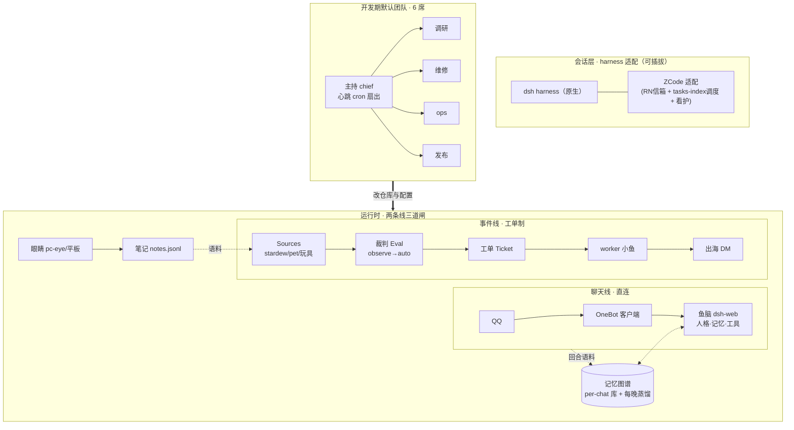

# 00 · 新手上路：从部署一条鱼，到搭起一支会自动干活的团队

> 目标读者：第一次接触本仓的人。读完能回答三个问题：**怎么把一条鱼部署起来、怎么让事件线自己开工、怎么搭一支会推进项目的团队**。
> 路线图：第一条鱼（30 分钟，本地就够）→ 第一张工单（1 小时）→ 搭自己的默认团队（半天）。

## 总览图（先看懂再动手）



一图记住三句话：

1. **聊天永远直连**（延迟敏感、人格连续，不进工单）；
2. **其余一切事件走工单**（接收→裁判→worker→出海，每一步可审计、可回滚）;
3. **观察先于自动**（新来源先 observe 看 `would_accept`，对上人工判断再切 auto）。

---

## 第一条鱼（30 分钟，本地就够——默认无服务器）

```bash
bash install/local/seed.sh --dry-run    # 先看会做什么
bash install/local/seed.sh --yes        # 平台 + 记忆目录 + 起停/体检脚本
~/.feiyu/bin/start.sh                   # 起（Ctrl+C 停），浏览器开 http://127.0.0.1:3080
~/.feiyu/bin/doctor.sh                  # 体检
```

- Windows 用 `powershell -ExecutionPolicy Bypass -File install\local\seed.ps1 -Yes`，效果相同。
- 默认**不需要服务器、不需要 QQ**；`~/.feiyu/.env` 至少填 `API_KEY / API_BASE / MODEL_MAIN` 三项。
- 要 QQ 常驻 / 24/7 在线：有服务器的走 [04-deploy.md](04-deploy.md) **路线 B 的 01–05 步**（基础系统 → OneBot → 平台 → 记忆 → 聊天线）。
- 验收：doctor 全绿；接入 QQ 后发一句话有回复，重启后她还认得你（记忆连续）。

## 第一张工单（1 小时）

```bash
bash examples/weather/demo.sh --observe
```

- 玩具源 `examples/weather`：一个只会「报告天气异常」的 Source，先把 observe→auto 全流程跑通。
- 说明：真正的 superagent 编排器（工单面板/裁判/worker）目前随**服务器路线**部署（[04-deploy.md](04-deploy.md)，其脚本在服务器的 `~/dsh-superagent`，仓库不含二进制）；本地路线用上面的玩具源理解机制即可，`install/08-superagent.sh` 是服务器侧步骤，本地没有 sudo/systemd 就不要跑。
- 验收：`observe` 档看到 would_accept → 切 auto → 一张真工单走完 **触发→裁判→工单→worker→出海 DM** 全链。
- 线上真实数字（2026-11-07）：切 auto 首日 5 张工单，触发→派发 ≤7s，报告出海 4/4 送达（见 [docs/03-cases/](03-cases/)）。

## 搭自己的默认团队（半天）

- 读 [TEAM.md](../../framework/TEAM.md) + [roles/](../../framework/roles/)：6 席位 = 主持/架构/调研/维修/发布（+可选视觉），席位是岗位不是进程。
- 主持心跳：一条 `*/20 * * * *` cron 扇出（见 [adapters/](../../framework/adapters/)），做三件事——查信箱、看护中断会话、巡检生产。
- 验收：值守跑通一晚，中断的会话被定向唤醒。

## 上手即踩的坑（我们替你踩过了）

- 「改了没生效但日志无 error」：改 src 必须重编译（运行时加载编译产物）；部署后做**消费侧字节校验**（见 [docs/04-deploy.md](04-deploy.md) 附录）。
- 服务器非交互 shell 的 `TZ` 是 UTC：一切时间窗显式带时区。
- 会话定时任务每会话一条上限：调度走直写任务库（[adapters/zcode/](../../framework/adapters/)）。
- 免费池并发很浅：多会话同秒唤醒会互掐，心跳扇出要错峰。
- Windows 本地部署：`python3` 这个命令名经常不存在（实为 `python` / `py -3`）——种子脚本已兜底，认三个名字。
- `.ps1` 必须是 UTF-8 **带 BOM**：PowerShell 5.1 对无 BOM 文件按 ANSI 读，中文字符串一出现就炸引号。
- PowerShell 5.1 给外部命令传参会吃掉内嵌双引号：`node -p 'a.split(".")'` 会变语法错误——改用无引号写法（如拆 `node -v` 的输出）。

每一步的验收/回滚细节见 [docs/04-deploy.md](04-deploy.md)；出事故先查 [docs/05-runbook.md](05-runbook.md)。
